# DACOS project guide

This guide explains the current application, its files, and the main functions.
It describes what the code actually does, including the prototype limits.

## 1. What the project does

DACOS means **Digital Advanced Connected Operations & Safety**. This repository
implements Module C: a browser-based mine control room dashboard. Supervisors
can inspect an Overview, a worker directory, a fictional mine map, and an
environmental monitoring screen.

The current implementation covers phases 1–3: the visual shell, a basic backend
and database, and a telemetry simulator. It uses JavaScript, as requested by the
project owner, instead of the reference document's preferred TypeScript.

All telemetry is fictional. The application does not connect to mine equipment,
contact responders, make verified evacuation decisions, or operate SCADA. Some
secondary charts and diagram annotations are still static design fixtures.
Authentication, permissions, complete monitoring workflows, emergency actions,
and production deployment are later phases.

## 2. The folder structure

```text
Dacos-mine-control/
├── frontend/
│   ├── package.json
│   ├── index.html
│   ├── vite.config.js
│   ├── tailwind.config.cjs
│   ├── postcss.config.cjs
│   ├── src/
│   │   ├── main.js
│   │   ├── App.vue
│   │   ├── router.js
│   │   ├── styles.css
│   │   ├── components/
│   │   │   ├── Sidebar.vue
│   │   │   ├── GlobalHeader.vue
│   │   │   ├── DashboardContent.vue
│   │   │   └── TelemetryStatus.vue
│   │   ├── views/
│   │   │   ├── OverviewView.vue
│   │   │   ├── WorkersView.vue
│   │   │   ├── MapView.vue
│   │   │   └── EnvironmentalView.vue
│   │   ├── stores/telemetry.js
│   │   └── services/telemetry.js
│   ├── tests/telemetry.test.js
│   ├── scripts/check-layout.mjs
│   ├── public/assets/
│   ├── design-reference/
│   └── dist/                    # Generated production frontend
├── backend/
│   ├── package.json
│   ├── src/
│   │   ├── server.js
│   │   ├── app.js
│   │   ├── services/telemetry.js
│   │   ├── realtime/index.js
│   │   ├── repositories/postgres.js
│   │   └── simulation/
│   │       ├── adapter.js
│   │       └── fixtures.js
│   ├── prisma/
│   │   ├── schema.prisma
│   │   └── migrations/
│   │       ├── migration_lock.toml
│   │       └── 202611130001_initial/migration.sql
│   ├── scripts/
│   │   ├── database.mjs
│   │   └── prisma.mjs
│   └── tests/
│       ├── simulator.test.js
│       └── api.test.js
├── shared/
│   ├── package.json
│   └── contracts.js
├── scripts/
│   ├── npm
│   └── dev.mjs
├── docs/
│   ├── PROJECT_GUIDE.md
│   ├── backend.md
│   └── ui-extraction.md
├── package.json
├── package-lock.json
├── vitest.config.js
├── README.md
├── dacos.md
├── .env.example
├── .gitignore
├── .data/                      # Ignored local database and credentials
├── .tools/                     # Ignored local Node/npm installation
└── node_modules/               # Installed libraries and workspace links
```

`frontend/` owns browser code, styles, visual references, and browser tests.
`backend/` owns the API, simulation, persistence, migrations, and server tests.
`shared/` contains only the data contracts used by both sides. There is no
frontend production import of backend application code.

The repository uses **npm workspaces**. The root package manages the whole
project; each workspace declares its own dependencies. There is one root
lockfile. npm normally installs shared packages into root `node_modules/` and
links `@dacos/frontend`, `@dacos/backend`, and `@dacos/contracts` to these folders.
Do not create competing lockfiles by installing the workspaces as unrelated
projects.

## 3. How a reading reaches the screen

```mermaid
flowchart LR
    Fixtures[Backend fictional fixtures] --> Adapter[SimulationAdapter]
    Adapter --> Service[TelemetryService validates and queues updates]
    Service --> Database[(PostgreSQL transaction)]
    Database --> Commit[Committed current snapshot]
    Commit --> REST[Express REST API]
    Commit --> Socket[Socket.IO snapshots and events]
    Socket --> Gate[Frontend schema and sequence checks]
    Gate --> Store[Pinia telemetry store]
    Store --> Views[Vue screens and SVG markers]
    Views --> Scenario[Demo scenario selection]
    Scenario --> REST
    REST --> Service
```



1. The adapter generates values from fixtures and a deterministic random seed.
2. The service validates the snapshot and saves it in one database transaction.
3. Only after a successful save does it expose the snapshot and notify listeners.
4. Socket.IO sends the snapshot to connected browsers.
5. The browser validates the payload and rejects duplicates or older packets.
6. Pinia stores the accepted snapshot. Vue updates the numbers and marker
   positions that depend on it.

The current read endpoints serve the service's **last committed in-memory
snapshot**. They do not query every database table again for each request.
PostgreSQL stores the same current entities/readings, and `/api/health` checks
its connectivity. Restarting the simulator creates a new stream and seeds new
current simulation values; this is not historical playback.

## 4. Root files and development tools

| File/folder | Function |
| --- | --- |
| `package.json` | Declares the workspaces, Node requirement, shared test runner, dependency overrides, and commands that delegate to frontend/backend. |
| `package-lock.json` | Records exact resolved library versions, integrity hashes, and workspace links for repeatable installation. Generated by npm. |
| `vitest.config.js` | Runs frontend and backend tests from the repository root, sets timeouts, and avoids parallel test files competing for the test database. |
| `scripts/npm` | A Bash wrapper that selects the local Node/npm runtime, changes to the project root, and forwards your npm arguments. |
| `scripts/dev.mjs` | Starts and stops the complete development application. Detailed functions are below. |
| `.env.example` | Documents optional database URL, frontend/API ports, random seed, simulation interval, and scenario-control setting. Contains no actual credential. |
| `.env` | Optional private configuration you create locally. Ignored by Git. |
| `.gitignore` | Excludes installed libraries, frontend build output, runtime/database files, local environment files, and coverage output. |
| `dacos.md` | Product requirements, phase boundaries, visual identity, and simulation constraints. |
| `README.md` | Quick setup, commands, and links to deeper documentation. |
| `docs/PROJECT_GUIDE.md` | This full file/function explanation. |
| `docs/backend.md` | API table, database behavior, realtime payloads, and simulator boundaries. |
| `docs/ui-extraction.md` | Maps views to original exports and records intentional visual/dynamic differences. |
| `.tools/` | The project-local Node.js 22 executable, npm, and their runtime/support files. Third-party tooling, not application source. |
| `node_modules/` | Third-party implementation code installed from the lockfile. npm manages it; change declared dependencies rather than editing library files. |
| `.data/` | Local PostgreSQL clusters, their internal files, and generated credential files. Database-managed state, not source code. |

### `scripts/dev.mjs`

- Resolves the repository root from its own location so startup does not depend
  on your terminal's current directory.
- Uses workspace-aware module resolution to find Prisma and Vite executables.
- Loads root `.env` when present.
- Starts local PostgreSQL only when `DATABASE_URL` is absent.
- Runs tracked migrations, then starts the API and Vite as child processes.
- `run(file, args, wait)` launches a Node program. With `wait = true`, migration
  success is required before startup continues. Long-running child failure
  triggers coordinated shutdown.
- `shutdown(code)` stops owned children, waits briefly for them to exit, stops
  the owned local database, and sets the exit code. A guard prevents duplicate
  shutdown. SIGINT/SIGTERM handlers support Ctrl+C and process termination.

It does not stop an unrelated database or Vite process. `--strictPort` causes a
clear failure rather than silently choosing a different frontend port.

## 5. Frontend entry, configuration, and styling

| File | Function |
| --- | --- |
| `frontend/package.json` | Browser runtime dependencies and frontend-specific dev/build/preview/test/browser-check commands. |
| `frontend/index.html` | The document served by Vite. Sets metadata, dark mode, local font stylesheet, body classes, the `#app` mounting element, and the module entry script. |
| `frontend/vite.config.js` | Enables Vue single-file components, reads root environment configuration, allows workspace source imports, and proxies `/api` and `/socket.io` to Express. |
| `frontend/tailwind.config.cjs` | Scans Vue/JS/HTML files and defines the exported design's colors, fonts, sizes, spacing, and plugins. Content paths are relative to this config. Environmental colors use `env-` names to preserve that export's separate palette. |
| `frontend/postcss.config.cjs` | Tells PostCSS to compile the explicitly located Tailwind configuration and apply Autoprefixer. |
| `frontend/src/main.js` | Creates the Vue application, installs Pinia and Vue Router, imports global CSS, and mounts `App.vue` into `#app`. |
| `frontend/src/App.vue` | Root application component. Starts telemetry on mount, stops it on unmount, displays the current route, and includes the common simulation status strip. Applies the environmental theme wrapper for that route. |
| `frontend/src/router.js` | Maps `/`, `/workers`, `/map`, and `/environmental` to lazily loaded screens; unknown paths redirect to Overview. Resets scroll position on navigation. |
| `frontend/src/styles.css` | Tailwind directives, source scrollbar/font/stripe styles, focus states, drawer/backdrop styles, responsive header/panel rules, status-strip styling, and reduced-motion behavior. |

Vite is the frontend development/build tool; it is not the API server.
Tailwind classes such as `flex`, `grid`, `text-cyan-400`, and `p-4` become CSS
at build time. Responsive prefixes such as `xl:` apply only at their breakpoint.
The `.cjs` extension explicitly selects CommonJS for Tailwind/PostCSS config;
`.js` and `.mjs` application modules use ES-module `import`/`export`.

### Reading a Vue component

A `.vue` file has a `<script setup>` section for JavaScript and a `<template>`
for markup. For example:

```vue
<script setup>
import { useTelemetryStore } from '../stores/telemetry.js'
const telemetry = useTelemetryStore()
</script>

<template>
  <span>{{ telemetry.metric('ch4', 'S-304', 2) }} % Vol</span>
</template>
```

The template displays a formatted methane reading from sensor S-304. When the
store changes, Vue updates that text. Important syntax used throughout:

| Syntax | Meaning in this project |
| --- | --- |
| `ref(value)` | A reactive value, such as the drawer's open state or search query. JavaScript accesses `.value`; templates unwrap refs. |
| `computed(() => ...)` | A derived reactive value, such as the overall quality state or KPI counts. |
| `{{ expression }}` | Inserts the expression's text into the template. |
| `:attribute="expression"` | Binds an attribute/property, including CSS classes and SVG transforms. |
| `@click="handler"` | Runs JavaScript for a user event. |
| `v-model="query"` | Keeps the worker search input and query ref synchronized. |
| `v-if` | Creates/removes an element conditionally, such as the drawer backdrop. |
| `v-show` | Shows/hides existing worker rows without recreating them. |
| `v-for` and `:key` | Render stable option lists, such as the scenario selector. |
| `defineProps` / `defineEmits` | Define inputs and emitted events between a view and layout components. |
| `?.` and `??` | Safely access data that may not have arrived and provide an explicit placeholder. |

### Components and views

| File | Responsibilities and important code |
| --- | --- |
| `components/Sidebar.vue` | Overview's navigation rail. The `open` prop controls the mobile drawer, `close` is emitted when closing or navigating, and RouterLink connects available pages. Future destinations remain disabled placeholders. |
| `components/GlobalHeader.vue` | Overview's persistent header, simulation notice, source state, timestamp and profile artwork. Receives `navigationOpen`; emits `toggle-navigation`. |
| `components/DashboardContent.vue` | Overview's KPI cards, SVG mine map, atmospheric cards, incident illustration, vitals, and footer. Calls store helpers to render live simulated values. It deliberately retains the exported SVG/layout markup. |
| `components/TelemetryStatus.vue` | Shows the simulation notice, connection/quality state, source, snapshot timestamp, errors, fixture disclaimer, and scenario selector. Selection calls `telemetry.setScenario`. |
| `views/OverviewView.vue` | Arranges the three Overview layout components. Owns `navigationOpen` and the backdrop close event. |
| `views/WorkersView.vue` | Direct extraction of the worker-directory export, including its own source header/sidebar, table, and inspector. `query` holds the search text, `matchesWorker(id)` filters rows against loaded worker names/IDs/roles, and `selectedWorker` controls inspector identity and primary biometric readings. Some dossier/diagram annotations remain fixtures. |
| `views/MapView.vue` | Direct extraction of the map export. Preserves tunnel paths, gradients, hazard overlays, HUD panels, and inspector. Uses `telemetry.point` for fictional worker marker movement and `telemetry.metric` for bound sensor labels. Owns its mobile drawer ref. |
| `views/EnvironmentalView.vue` | Direct extraction of the environmental export. Preserves its own colors, gas matrix, SCADA diagrams, trend illustration, and inspection cards. Primary atmospheric values come from the store; hardware controls remain disabled. Owns its mobile drawer ref. |

The three newer exports contain their own visual shell. They retain that markup
rather than being forced into Overview's slightly different shell. Consequently,
sidebar/header markup appears in those views as well as the shared Overview
components. This preserves the supplied designs, but future design changes may
need to be applied to all affected shells.

SVG paths (`d`), circles, lines, polygons, gradients, and text form the mine
illustrations. They are browser-rendered vector geometry, not a surveyed map or
a Leaflet positioning implementation. Backend position offsets move selected
markers within the fictional coordinate frame.

## 6. Frontend telemetry code

### `frontend/src/services/telemetry.js`

This file contains pure validation/order/freshness helpers, not network calls.

| Function | Explanation |
| --- | --- |
| `validateSnapshot(input)` | Uses the shared Zod schema's `safeParse`: returns a success/failure result without throwing on invalid external packets. |
| `qualityFor(reading, options)` | Determines offline, unavailable, stale, simulated, or future live quality. Transport loss takes priority; null/missing values are unavailable; old timestamps or missing updates are stale. |
| `createSnapshotGate()` | Creates a closure storing active stream ID, last sequence, and retired streams. Its returned function validates input, rejects old/duplicate packets, accepts a new server session, and prevents a retired session from overwriting it. |

### `frontend/src/stores/telemetry.js`

`useTelemetryStore` defines the shared Pinia store. Every screen uses the same
connection and accepted snapshot. Important state and functions:

| Member | Explanation |
| --- | --- |
| `snapshot` | Latest accepted complete telemetry payload, initially null. |
| `connected` | Socket connection availability. |
| `now`, `lastReceived` | Local freshness clock and last accepted update time. |
| `error`, `busy` | Visible connection/request message and pending scenario-request state. |
| `state` | Derived overall state. Missing connection/data, disconnected/stale scenario, or late packets affect this value. |
| `workers`, `alerts` | Derived lists from the snapshot; empty until data arrives. |
| `read(metric, deviceId)` | Finds the requested reading in the accepted snapshot. |
| `metric(name, deviceId, digits)` | Applies quality rules, returns `—` for offline/unavailable values, and formats numeric values to the requested precision. |
| `mean(name, digits)` | Computes supported aggregate numeric metrics; returns `—` when unavailable/offline or there are no numeric values. |
| `point(deviceId, baseX, baseY)` | Converts a fictional position offset into an SVG `translate(...)` string relative to the source marker and zone origin. |
| `receive(input)` | Passes a packet through the gate. Accepted packets replace the snapshot, refresh `lastReceived`, and clear connection errors. |
| `start()` | Opens one Socket.IO client, registers connection/error/snapshot handlers, enables reconnection, and starts a 500ms local freshness clock. |
| `stop()` | Disconnects the socket, clears the clock timer, and marks the store disconnected. |
| `setScenario(scenario)` | Posts a validated scenario request to the API, accepts its returned snapshot, reports errors, and resets the busy flag in `finally`. |
| `workerStatus(id)` | Returns overall unavailable/stale/offline state first, otherwise a matching synthetic alert severity or normal. |
| `summary` | Derives worker/device/incident KPI counts. Current-activity counts become unavailable when data is not usable. |

There is no browser-side random reading generator. Stale values remain visibly
stale; offline values are not silently replaced with synthetic readings.

## 7. Backend files and functions

### `backend/package.json`

Declares Express, Socket.IO, Prisma Client, and the shared contracts as runtime
dependencies. Prisma CLI, the local database launcher, and Supertest support
development/tests. Contains independent API/database/test commands.

### `backend/src/server.js`

This is the backend entry point. Its top-level code requires `DATABASE_URL`,
creates the repository, checks PostgreSQL, creates the simulation adapter and
service, saves the first snapshot, creates Express and the HTTP server, attaches
Socket.IO, starts the update timer, and listens on loopback.

`stop()` guards against duplicate shutdown, stops updates, closes realtime
connections, and disconnects Prisma. SIGINT/SIGTERM invoke it.

### `backend/src/app.js`

`createApp({ service, repository, allowSimulationControl })` constructs Express
without starting a listening socket. Keeping construction separate from startup
lets tests send requests through Supertest.

It disables `X-Powered-By`, limits JSON bodies, prevents API caching, registers
GET routes, validates query parameters, implements the demo scenario POST,
returns JSON 404s for unknown API routes, and centralizes error responses.
Zod errors and malformed JSON return 400; unavailable telemetry returns 503.

The route handlers provide health, a committed snapshot, summary counts, worker
search/details, zones, devices, health/environmental readings, alerts, and
incidents. The only implemented mutation changes a simulation scenario. Its
origin check and enable/disable flag are local prototype protections, not
production user authentication. See `backend.md` for the full route table.

### `backend/src/services/telemetry.js`

| Function/method | Explanation |
| --- | --- |
| `TelemetryService.constructor` | Receives the adapter and repository; initializes current state, listeners, timer, pending promise queue and last error. |
| `subscribe(listener)` | Registers a callback and returns an unsubscribe function. Realtime delivery uses it. |
| `update(scenario)` | Queues the operation after earlier updates, advances/changes the adapter, validates its snapshot, persists it, then replaces current state and notifies listeners. Failed persistence is recorded and rethrown. |
| `start(interval)` | Schedules queued updates, normally every 2 seconds. |
| `stop()` | Clears the timer and waits for pending persistence to settle. |
| `snapshot()` | Returns the last committed snapshot; throws 503 when none is available or the latest persistence failed. |
| `workerStatus(snapshot, worker)` | Derives offline/stale state or a matching alert severity/normal status. |
| `summary(snapshot)` | Derives the API's KPI counts and includes source/scenario/timestamp metadata. Unusable current counts are null. |

The promise queue prevents a timer update and a user's scenario change from
writing/publishing in conflicting order.

### `backend/src/repositories/postgres.js`

`createRepository(url)` creates a Prisma Client and returns these members:

- `db`: the client, used directly by integration tests to inspect persisted rows.
- `health()`: runs a parameterized `SELECT 1` connectivity check.
- `save(input)`: validates the snapshot, then uses one transaction to upsert
  zones, workers, devices, and current readings. Converts timestamps to Date
  objects and JavaScript null to Prisma's JSON-null value. Replaces current
  alerts/incidents to match the current scenario. No update is published before
  this completes.
- `close()`: disconnects Prisma's connection pool.

Stable device/metric reading IDs keep storage bounded. This is current state,
not an ever-growing telemetry archive or incident audit history.

### `backend/src/simulation/fixtures.js`

Exports `zones`, `workers`, and `devices`. Zones contain fictional coordinates
and depths; workers have IDs, names, roles, shifts, and zone assignments; devices
list their capabilities and assignments. Array `map` calls turn concise fixture
tuples into named objects and generate tags/nodes consistently.

`thresholds` records an example methane threshold proposal. It is currently
reference fixture metadata; the adapter uses fixed scenario values and there is
no implemented threshold-editing endpoint or engineering validation.

### `backend/src/simulation/adapter.js`

| Method/helper | Explanation |
| --- | --- |
| `SimulationAdapter.constructor` | Accepts a seed, injectable clock and initial scenario; creates a new session UUID and sequence counter. |
| `random()` | A seeded linear-congruential generator. Equal seeds and call sequences yield repeatable pseudo-random values. |
| `setScenario(scenario)` | Validates the scenario, resets event start time, and generates its next snapshot. |
| `snapshot()` | Returns the previous snapshot or generates the first one. |
| `advance()` | Increments sequence, reads the clock, generates supported readings, builds synthetic alerts/incidents, and validates the full result. |
| Local `noisy(base, scale)` | Adds a small repeatable variation and rounds values. It does not represent calibrated sensor noise. |
| Local `add(...)` | Creates a reading with IDs, units, timestamp and quality. During disconnection/staleness it preserves prior values/timestamps instead of manufacturing fresh data. |

Wearables provide heart rate, SpO₂, temperature, battery and fictional position.
Respiration/fatigue are null/unavailable. Environmental nodes provide 12 named
metrics. Eight wearables × seven readings plus four nodes × 12 readings produce
104 current readings. Warning/critical scenarios create a methane demo alert;
impairment preserves a known incident rather than issuing a false all-clear.

### `backend/src/realtime/index.js`

`attachRealtime(server, service)` creates a Socket.IO server on the same HTTP
server as Express. Its connection handler immediately sends the current
snapshot, allowing a new/reconnecting browser to catch up.

Its service subscription broadcasts complete snapshots and individual named
reading/status events. `previous` tracks alert state so repeated ticks do not
continually emit the same `alert:created` event. The returned object contains
`io` and `close()`, which unsubscribes and shuts down Socket.IO.

### Backend helper scripts

| File/function | Explanation |
| --- | --- |
| `backend/scripts/database.mjs` → `startDatabase(options)` | Resolves the cluster relative to the repository, creates/loads a private random local password, initializes PostgreSQL when absent, starts it on loopback, creates the named database if missing, and returns its URL plus a stop function. Uses existing `.data/` paths regardless of current working directory. |
| `backend/scripts/prisma.mjs` | Loads root `.env`, resolves the workspace's Prisma executable and schema, forwards CLI arguments such as `generate`/`migrate deploy`, and preserves the child exit status. Makes database commands work from either root or backend workspace. |

## 8. Database schema and migrations

`backend/prisma/schema.prisma` is the readable source of the database model.
Its generator config tells Prisma to generate the JS client. Its datasource
config selects PostgreSQL and reads `DATABASE_URL`.

| Model | Stored data and relationships |
| --- | --- |
| `Zone` | ID, name, depth, JSON geometry; relates to workers and devices. |
| `Worker` | Fictional identity, role, shift and zone foreign key; relates to devices. |
| `Device` | Type, optional assigned worker, zone foreign key and JSON capability list. |
| `Reading` | Stable ID, kind/metric, device/worker/zone identifiers, JSON value, unit, timestamp, source, simulation flag, quality and sequence. Indexes support kind/zone and worker lookups. |
| `Alert` | Current synthetic severity/type, related identifiers, status, timestamp, source/quality, simulation flag and message. |
| `Incident` | Current demo event with alert/worker/zone identifiers, severity/status, timestamp, source/quality, simulation flag and JSON timeline. |

The schema currently enforces Zone/Worker/Device relationships. Reading,
Alert, and Incident reference identifiers are stored as scalar fields rather
than declared Prisma relations. This is the initial model, not a complete
production relational design.

`migrations/202611130001_initial/migration.sql` creates the corresponding tables,
primary keys, indexes and declared foreign keys. `migration_lock.toml` records
that these migrations target PostgreSQL. Prisma also maintains its internal
migration tracking table in the database.

`db:generate` regenerates client code from the schema; it does not create tables.
`db:migrate` applies tracked SQL migrations; it does not generate new migration
files. Generated Prisma code lives in installed dependency directories and
should not be hand-edited.

## 9. Shared contracts

`shared/package.json` exposes the `@dacos/contracts` workspace and declares Zod.
`shared/contracts.js` defines these runtime validators:

| Export | Validates |
| --- | --- |
| `scenarioSchema` | normal, warning, critical, disconnected, stale. |
| `qualitySchema` | simulated, live, stale, offline, unavailable. The simulator never claims an actual live hardware source. |
| `metadataSchema` | ID, ISO timestamp, source, explicit simulation flag and quality. |
| `readingSchema` | Metadata plus reading kind, related IDs, metric, number/position/null value, unit and sequence. |
| `workerSchema`, `zoneSchema`, `deviceSchema` | Entity fields and device capability lists. |
| `alertSchema`, `incidentSchema` | Synthetic alert/incident fields and timestamped incident timeline. |
| `snapshotSchema` | Complete simulator envelope: UUID stream ID, sequence, timestamp, source, scenario and all entity/reading arrays. |
| `filterSchema` | Allowed worker search/zone/status query parameters; rejects unknown fields. |

`.parse()` throws on invalid input; backend middleware translates request
validation errors into 400 responses. `.safeParse()` gives the frontend a
nonthrowing result so invalid packets can be ignored. These contracts currently
require a simulator source and simulation flag; real hardware needs an explicit
contract/adapter change, not an automatic fallback.

## 10. Tests and browser checking

| File | What it verifies |
| --- | --- |
| `backend/tests/simulator.test.js` | Deterministic readings, unavailable capabilities, all scenarios, retained timestamps/incidents on impairment, invalid scenario rejection, and no publication after failed persistence. |
| `backend/tests/api.test.js` | Starts a separate real PostgreSQL cluster, applies migrations, verifies rows, tests REST endpoints/filter validation/origin rejection, persists scenario transitions, and verifies Socket.IO initial/reconnect/reading events. `beforeAll` prepares the test system; `afterAll` closes clients, service, server and database. |
| `frontend/tests/telemetry.test.js` | Tests the browser's packet gate and freshness rules. Imports the pure backend adapter as a test fixture generator; this is not a production frontend dependency on backend execution. |
| `frontend/scripts/check-layout.mjs` | Connects to an already-running Chrome debugging endpoint, drives routes and viewport sizes, checks mounting/simulation text/page widths, opens/closes drawers, and exercises scenario selection against the running API. |

The browser script's `send` function pairs Chrome protocol requests/replies by
ID; `evaluate` runs browser-side expressions and reports exceptions. It checks
1920, 1440, 1366, 1024, 768, 390 and 360px widths and returns a nonzero exit code
on failure. It requires Chrome on debugging port 9223 and an already-running
app. `BASE_URL` changes the app URL. It is not a general browser screenshot or
visual pixel-diff test.

## 11. Visual references, assets, and generated files

| Files | Function |
| --- | --- |
| `frontend/design-reference/code.html`, `screen.png`, `DESIGN.md` | Original Overview markup, reference screenshot, and design notes. |
| `frontend/design-reference/mine-controll/{code.html,screen.png,DESIGN.md}` | Original worker directory markup, screenshot and notes. The source folder's original spelling is retained. |
| `frontend/design-reference/map/{code.html,screen.png,DESIGN.md}` | Original mine-map markup, screenshot and notes. |
| `frontend/design-reference/eviro/{code.html,screen.png,DESIGN.md}` | Original environmental markup, screenshot and notes. The source folder's original spelling is retained. |
| `frontend/public/assets/fonts.css` | Local `@font-face` declarations and Material Symbols icon class. |
| `font-0-0.ttf` through `font-0-3.ttf` | Inter UI font weights 400, 500, 600, 700. |
| `font-0-4.ttf` through `font-0-7.ttf` | JetBrains Mono telemetry font weights 400, 500, 600, 700. |
| `font-2-0.ttf` through `font-2-6.ttf` | Material Symbols icon font weights 100–700. Icon names in spans select glyphs. |
| `image-1.png` | Profile artwork from the original export. |
| `reference-703374936b15.png` | Worker inspector portrait from the worker export. |
| `reference-01fb3460db55.png`, `reference-e0e84e4f5523.png` | The map export's inspector portrait/tunnel camera artwork; views reference the corresponding file directly. |
| `frontend/dist/index.html` | Generated production HTML referencing bundled assets. |
| `frontend/dist/assets/*.js` | Generated application, shared-library and lazily loaded screen bundles. Hashed filenames change when content changes. |
| `frontend/dist/assets/*.css` | Generated compiled Tailwind/application CSS. |
| Copied production fonts/images | Static public assets copied into the production output by Vite. |

The exported HTML is a visual reference, not a runtime HTML page loaded inside
Vue. Source-side inline demo scripts were replaced with Vue behavior. The logo
is still referenced from its original external URL, which has returned HTTP
403; a full pixel-perfect visual match is therefore not claimed.

## 12. Commands and a suggested reading order

Run commands from the root, using the wrapper if your global Node is older
than 22.16:

```sh
./scripts/npm install          # One install for all workspaces
./scripts/npm run dev          # Local DB + API + frontend
./scripts/npm run build        # Writes frontend/dist
./scripts/npm test             # All automated tests
./scripts/npm run test:frontend
./scripts/npm run test:backend
./scripts/npm run db:generate
./scripts/npm run db:migrate   # Requires configured DATABASE_URL
```

The default frontend is http://127.0.0.1:5173. If occupied:

```sh
FRONTEND_PORT=5174 ./scripts/npm run dev
```

`dev:api` and `dev:frontend` start only the named side; they do not automatically
provide the other side or a database. With a configured PostgreSQL URL they can
be run separately. `preview` serves the frontend build only; deployment needs
an API/Socket.IO proxy as well.

For a beginner, read in this order:

1. `frontend/src/main.js` → `App.vue` → `router.js` to understand startup/screens.
2. `TelemetryStatus.vue` → frontend store → frontend telemetry helpers to follow
   what the browser renders and how it handles missing data.
3. `backend/src/server.js` → service → simulation adapter to follow generation.
4. Repository → Prisma schema → initial migration to follow persistence.
5. Shared contracts → API handlers → realtime module to understand the wire data.
6. Tests to see expected behavior and failure cases as executable examples.

## 13. Frontend-only hosted preview

`build:preview` selects Vite's `static-preview` mode. The root
`.env.static-preview` sets `VITE_STATIC_PREVIEW=true`. In this mode the store
loads `frontend/src/preview/snapshot.json`, labels it as frozen fictional data,
keeps socket connectivity false, and never opens a socket or calls the API.
It evaluates fixture quality against its fixed timestamp rather than treating
the snapshot as a current reading. Unsupported values stay unavailable.
Scenario mutation is disabled. `frontend/tests/preview.test.js` verifies these
behaviors. Preview navigation uses URL hashes so deep links work on static hosts.

The ordinary build still uses the backend and freshness rules described above.
A backend outage cannot automatically activate preview mode. `.preview-site/`
is an ignored, isolated frontend deployment checkout, with its Site ID in
`.openai/hosting.json`. It contains no backend, database, or credential files.

## Device connectivity extension

See [DEVICE_CONNECTIVITY.md](DEVICE_CONNECTIVITY.md) for setup and the complete
packet contract. Worker Detail (`/workers/:id`), the phone simulator
(`/device-simulator`) and BLE gateway (`/ble-gateway`) reuse the Pinia snapshot.
`backend/src/services/devices.js` manages pairing, authorization and packet order.
The new migration adds DeviceRegistration, DeviceTelemetry and IncidentEvent.
Device records persist independently of scenario state; token hashes are never
published. W-014 is an additional fictional demo worker, bringing live fixtures
to nine workers and 111 readings. The frozen static preview remains unchanged
and cannot ingest device data. Optional TLS/LAN configuration is off by default.

See [SECURITY_AND_MANAGEMENT.md](SECURITY_AND_MANAGEMENT.md) for authenticated startup, roles, management APIs and milestone verification.

Milestone 5 incident APIs, transitions, migrations and local manual testing:
[MILESTONE_5_INCIDENT_API.md](MILESTONE_5_INCIDENT_API.md).

Milestones 6–9 delivery, files, migrations, manual checks and limitations:
[MILESTONES_6_TO_9.md](MILESTONES_6_TO_9.md).
